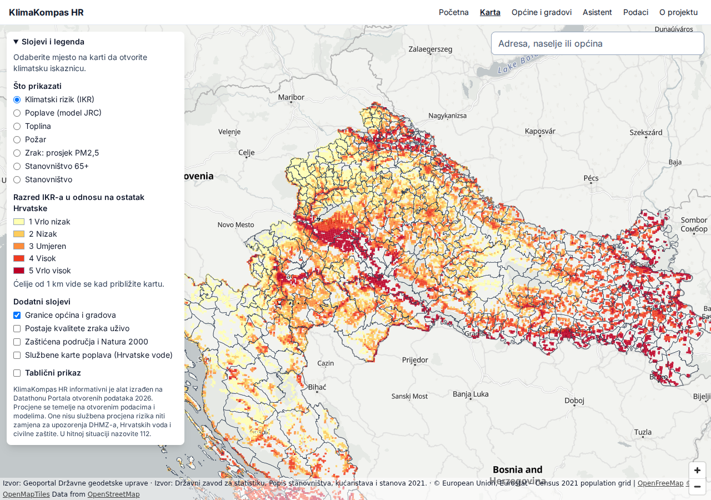
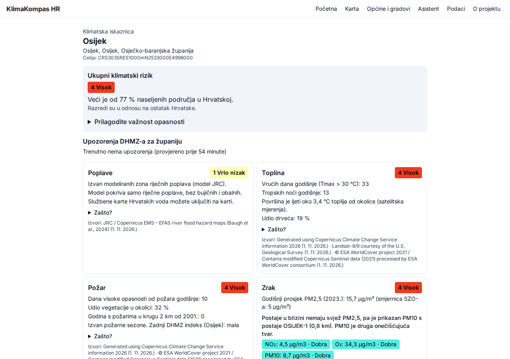
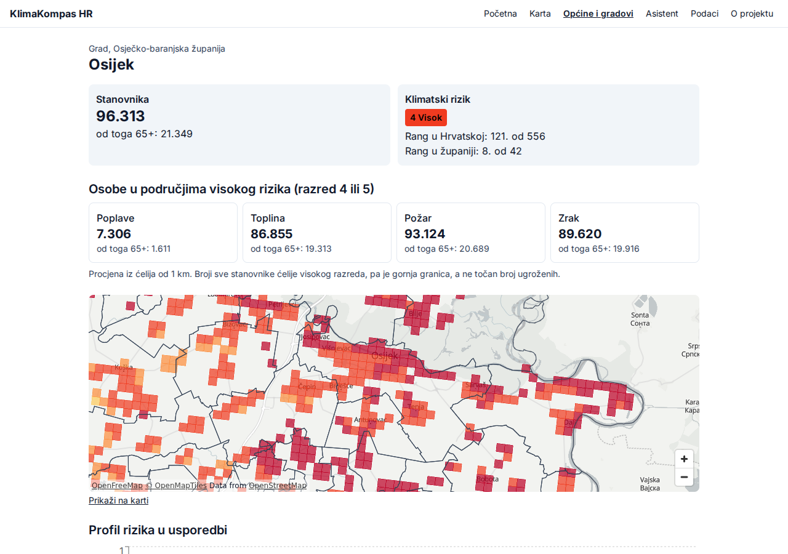
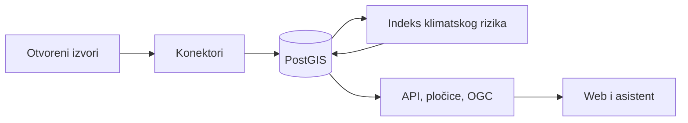

# KlimaKompas HR

[](https://github.com/dlukas99/klimakompas-hr/actions/workflows/ci.yml)

Klimatski rizik za svako mjesto u Hrvatskoj, iz otvorenih podataka: karta, „klimatska iskaznica” za bilo koju adresu, pregled za općine i gradove te AI asistent koji navodi izvor svake brojke.

**Demo:** javni URL bit će upisan ovdje nakon deploya (`docs/deploy.md`).

| Karta | Iskaznica | Općina ili grad |
|---|---|---|
|  |  |  |

## Kome je namijenjena

- **Općinama i gradovima:** koja su naša naselja najizloženija, gdje živi najviše starijih osoba u zonama rizika i kako stojimo u odnosu na županiju i Hrvatsku. Male jedinice to dobivaju bez vlastitog GIS-a i stručnjaka, kao podlogu za planiranje zaštite, zelenila i prijave projekata prilagodbe.
- **Građanima:** što prijeti njihovoj adresi, kakav je zrak danas, ima li upozorenja i što mogu učiniti.
- **Novinarima, udrugama i istraživačima:** rang-liste i izvedeni otvoreni podaci pod licencom CC BY 4.0.

## Što radi

- **Iskaznica za adresu, naselje ili općinu:** razina rizika od poplava, topline, požara i onečišćenja zraka, razlozi, broj stanovnika i rizik cijelog naselja i općine, živa upozorenja DHMZ-a, trenutni zrak s najbliže postaje, prognoza PM2,5, priroda u blizini i savjeti službenih izvora. Ako neki živi izvor kasni, iskaznica kaže koji.
- **Karta:** 1-km mreža, slojevi opasnosti i stanovništva, postaje uživo, zaštićena područja i službene karte Hrvatskih voda.
- **Za općine i gradove:** rang u Hrvatskoj i županiji, broj izloženih osoba, usporedba, naselja, CSV i ispis.
- **Asistent:** odgovara na pitanja na hrvatskom samo iz rezultata svojih alata, a svaka brojka prolazi provjeru utemeljenosti i ima izvor. Mali otvoreni model samo razumije pitanje; bez modela pitanje čitaju jednostavna pravila, pa slobodna i brza pitanja rade na svakom poslužitelju. Brza pitanja vežu se uz odabranu općinu ili grad.
- **Podaci:** status izvora uživo, provjere kvalitete, izvedeni skupovi, OpenAPI, OGC API i DCAT-AP.

## Kako radi



Za svaku ćeliju od 1 km računamo četiri opasnosti i križamo ih s ranjivošću stanovništva: `R = H × (0,5 + 0,5 · V)`. Indeks je prosjek tih rizika, a razredi su relativni, u odnosu na ostatak Hrvatske. Rezultati se zbrajaju i za naselja te općine i gradove. Detalji i ograničenja, npr. da satelitska povijest požara vidi samo veće požare, su u [metodologiji](docs/metodologija.md).

## Izvori podataka

DGU (granice, adrese), DZS (Popis 2021.), Eurostat (mreža stanovništva), JRC (karte poplava), EEA (PM2,5), Copernicus ECDE i DHMZ (klima), Landsat (površinska temperatura), ESA WorldCover (pokrov), MODIS (požari), DHMZ (upozorenja), MZOZT (kvaliteta zraka, Bioportal), Portal otvorenih podataka, Open-Meteo i Hrvatske vode. Potpun popis s licencama je u [izvorima podataka](docs/izvori-podataka.md), a dnevnik provjere u [izvori-provjera](docs/izvori-provjera.md).

## Brzi start

Potrebni su Docker s Composeom, `make`, [uv](https://docs.astral.sh/uv/) i Node (verzija u `.nvmrc`). Za ECDE treba besplatan Copernicus CDS račun s prihvaćenom licencom skupa, a token ide u `.env`.

```bash
make setup            # ovisnosti, .env iz predloška i pre-commit
make up               # PostGIS i Martin
make migrate          # sheme baze
make etl-all          # svi izvori; prvi put oko sat vremena, najdulje traje Landsat
make index            # Indeks klimatskog rizika
make tiles            # pločice
make api              # API na http://localhost:8000
make web              # web na http://localhost:5173
make worker           # po želji: osvježavanje upozorenja i kvalitete zraka
```

Aplikacija je tada na http://localhost:5173. Ako su zadani portovi zauzeti, promijenite `DB_PORT`, `MARTIN_PORT`, `API_PORT` i `WEB_DEV_PORT` u `.env` (i port u `DATABASE_URL`). Bez `make worker` upozorenja i mjerenja zraka ostaju na zadnjem dohvatu, a iskaznica to jasno navodi. AI model nije obavezan: za njega postavite `LLM_BASE_URL` i `LLM_MODEL` u `.env` (npr. lokalni Ollama).

Ostale naredbe: `make check` (testovi i provjere), `make e2e` (Playwright i axe), `make worker` (živi izvori), `make ml-train` (nowcast), `make quality`, `make export`, `make screenshots`, `make docs-pdf`. Produkcija: [deploy](docs/deploy.md).

## API i standardi

OpenAPI je na `/api/docs`, a opis u [api.md](docs/api.md). Dostupni su i vektorske pločice (`/tiles`), OGC API – Features (`/ogc`) i DCAT-AP katalog (`/api/v1/catalog.ttl`).

## Dokumentacija

[Projekt](docs/projekt.md) · [Arhitektura](docs/arhitektura.md) · [Metodologija](docs/metodologija.md) · [Preduvjeti](docs/preduvjeti.md) · [Kvaliteta podataka](docs/kvaliteta-podataka.md) · [Asistent](docs/agent.md) · [Nowcast](docs/ml.md) · [Pristupačnost](docs/pristupacnost.md) · [Korisnički vodič](docs/korisnicki-vodic.md) · [Daljnji razvoj](docs/daljnji-razvoj.md) · [Odluke](docs/odluke/)

## Licence

Kod je objavljen pod licencom [EUPL-1.2](LICENSE). Izvedeni podaci objavljeni su pod CC BY 4.0, osim skupova izvedenih iz karata poplava JRC-a, koji su pod ODbL 1.0 dok JRC ne potvrdi drugačije ([ADR 0003](docs/odluke/0003-licenca-izvedenog-sloja-poplava.md)). Atribucije su u [ATTRIBUTION.md](ATTRIBUTION.md), a ovisnosti u [alati-i-licence](docs/alati-i-licence.md).

## Ograničenje odgovornosti

KlimaKompas HR informativni je alat izrađen na Datathonu Portala otvorenih podataka 2026. Procjene se temelje na otvorenim podacima i modelima. One nisu službena procjena rizika niti zamjena za upozorenja DHMZ-a, Hrvatskih voda i civilne zaštite. U hitnoj situaciji nazovite 112.

## Tim

Tim Požega, FERIT Osijek: dlukas99 (GitHub) i Fabio Mandić. Mentor: dr. sc. Matej Džijan. Izrađeno za Datathon Portala otvorenih podataka 2026., izazov B – Okoliš i održivi prostor.

## AI alati

Claude Code (Anthropic) korišten je kao razvojni alat za pisanje i pregled koda i dokumentacije; sav izlaz pregledao je i testirao tim. Asistent u aplikaciji koristi open-weight model preko OpenAI-kompatibilnog API-ja i ne ovisi o jednom pružatelju.
