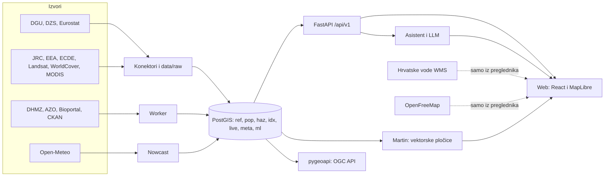

# Arhitektura

## Komponente

| Komponenta | Uloga | Tehnologija |
|---|---|---|
| Konektori | dohvat, parsiranje, idempotentno učitavanje, kontrole | Python, httpx, lxml, rasterio |
| Baza | svi podaci i izračuni | PostgreSQL 16, PostGIS 3.4 |
| Indeks | opasnosti, ranjivost, rizik, IKR | numpy, `config/index.yaml` |
| Worker | živi izvori po rasporedu iz `sources.yaml` | APScheduler |
| API | iskaznica, JLS, rang-liste, zrak, izvori | FastAPI, OpenAPI |
| Pločice | slojevi karte iz materijaliziranih pogleda | Martin (MVT) |
| OGC | standardni pristup podacima | pygeoapi |
| Web | karta, iskaznica, JLS ploča, asistent | React, MapLibre, Tailwind |
| Asistent | alati, provjera utemeljenosti, citati | OpenAI-kompatibilan API |
| Nowcast | prognoza PM2,5 s rasponom | LightGBM |

## Standardi

INSPIRE mreža i GML, EPSG:3035 za izračune, GeoJSON u EPSG:4326 u API-ju, OpenAPI 3, OGC API – Features, Mapbox Vector Tiles, CAP 1.2, DCAT-AP, RFC 9457 za greške i RFC 9309 za `robots.txt`.

## Tokovi

- **Statički slojevi** računaju se batchom. Rasteri se čitaju prozorima preko HTTP Rangea, a satelitske scene iz pregleda u COG datotekama, pa ne treba preuzimati cijelu Europu.
- **Živi slojevi** osvježavaju se po rasporedu. Ako izvor padne, ostaje zadnja dobra vrijednost i prikazuje se vrijeme zadnjeg osvježavanja.
- **Službene karte Hrvatskih voda** učitavaju se samo iz preglednika korisnika, nikad s našeg poslužitelja.

## Pouzdanost

- Svaki run bilježi se u `meta.etl_runs`, a greška vraća transakciju, pa prethodni podaci ostaju.
- Kontrole raspona i zbrojeva ruše učitavanje ako nisu zadovoljene.
- Web prikazuje poruku ako padne podloga, API ili model; nijedan ispad ne prazni stranicu.

## Privatnost

Ne bilježe se adrese, upiti ni razgovori: API radi bez access loga, Caddy nema log pristupa, a brojač ograničenja zahtjeva čuva se samo u memoriji. Nema analitike ni kolačića, a fontovi su na našem poslužitelju.

## Deploy

Vidi `docs/deploy.md`. Sve radi u Docker Composeu, a teške obrade rade se lokalno pa se baza prenosi na poslužitelj.
