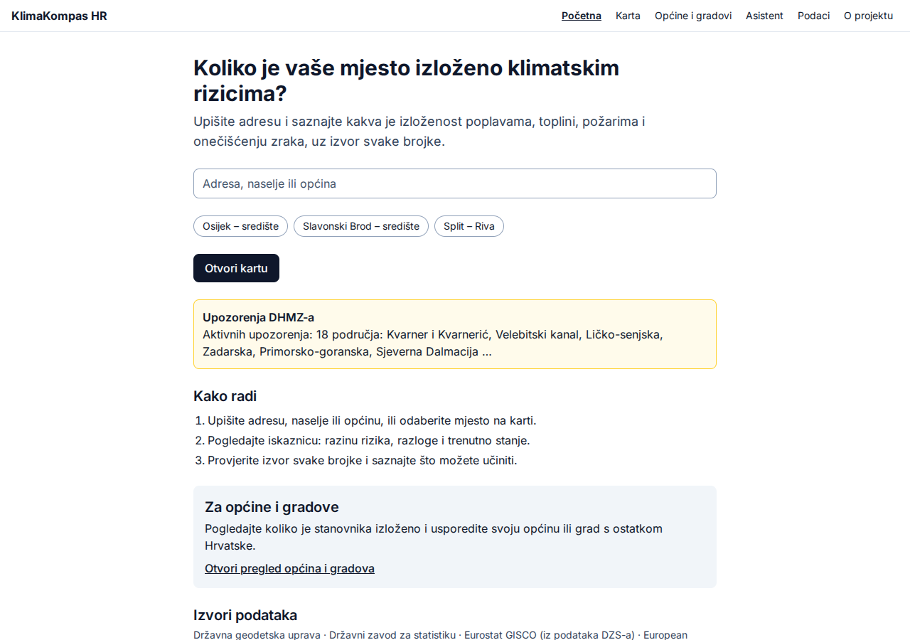
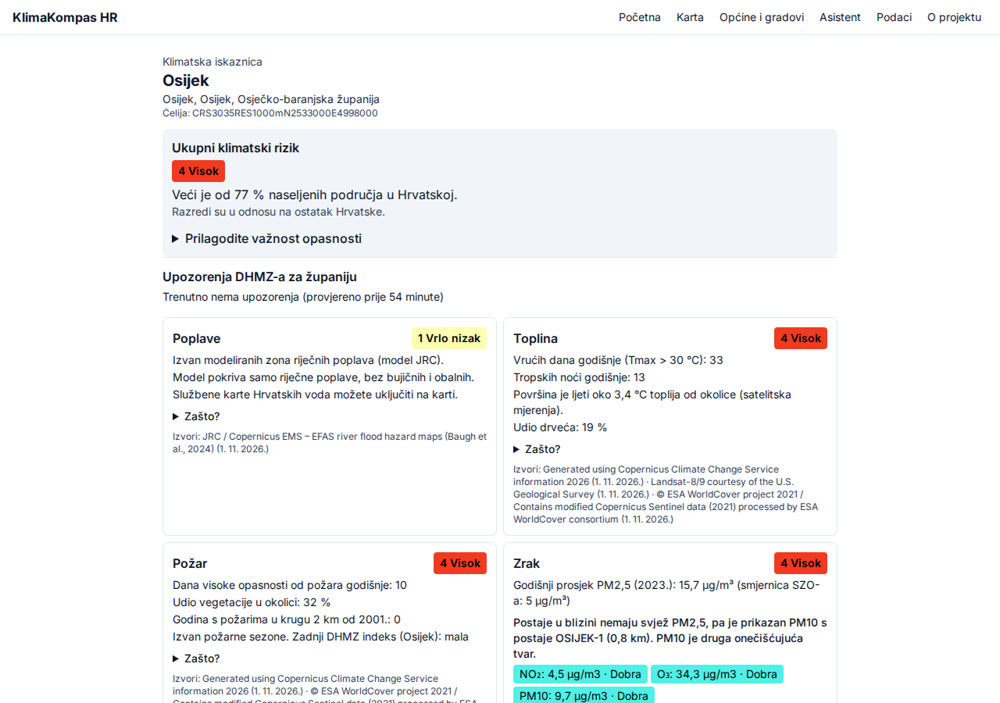
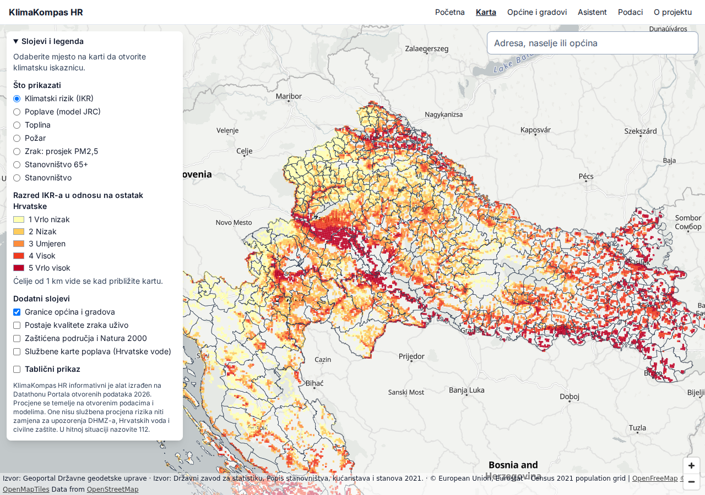
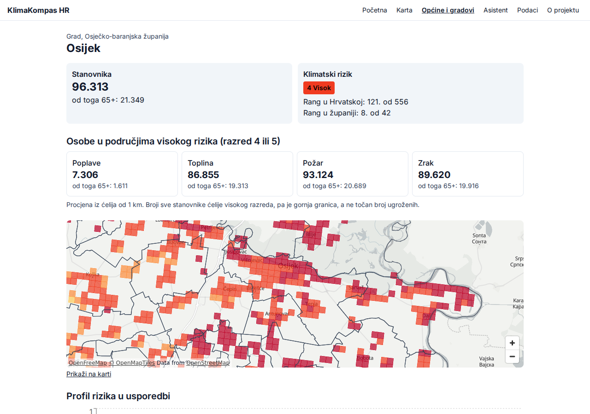
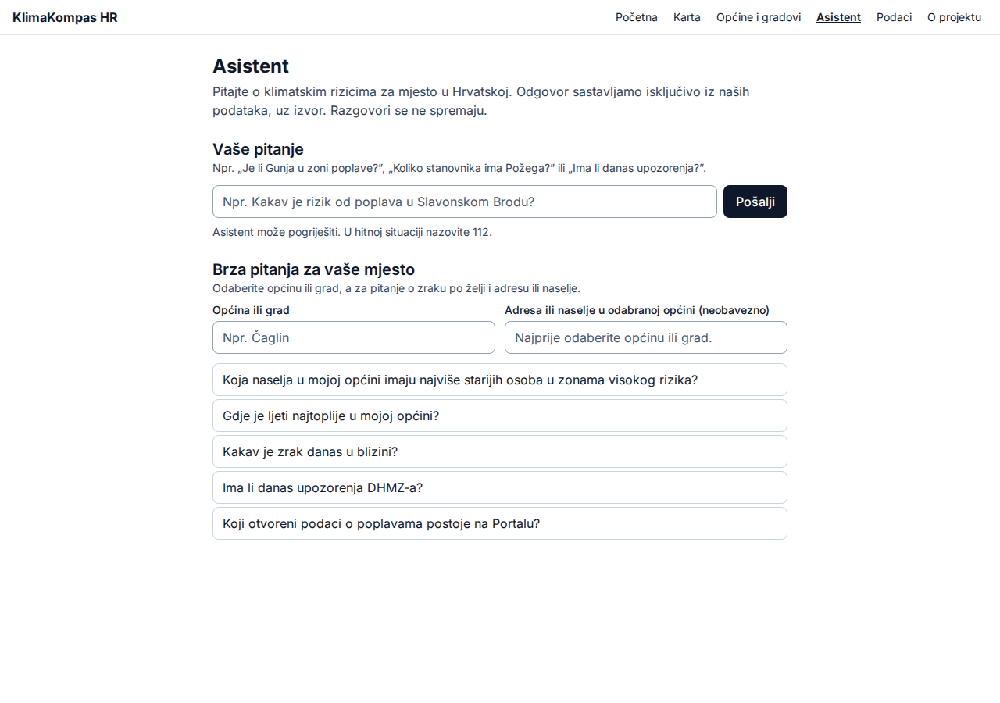
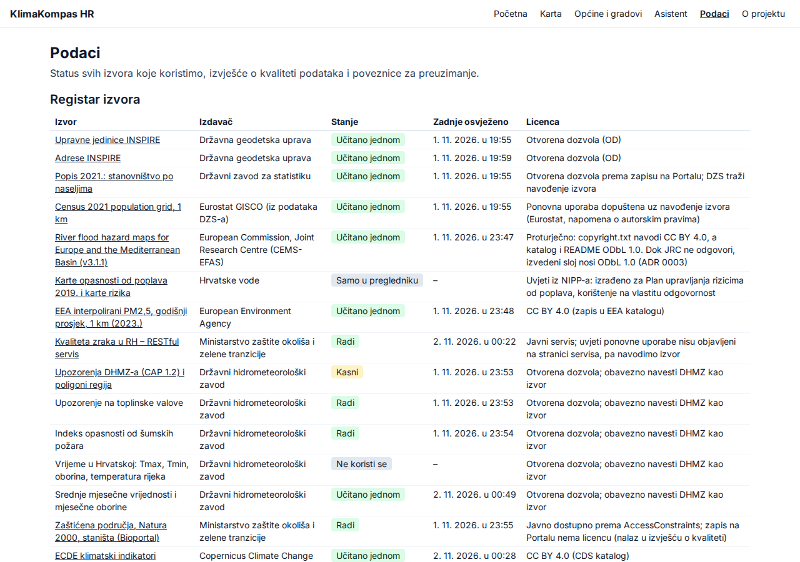

# Korisnički vodič

## Provjerite svoju adresu

1. Na početnoj stranici upišite adresu, naselje ili općinu. Dijakritici nisu obavezni, pa „Cakovec” nalazi Čakovec.
2. Odaberite rezultat i otvorit će se klimatska iskaznica.

## Kako čitati iskaznicu

- **Ukupni klimatski rizik:** razred od 1 do 5 u odnosu na ostatak Hrvatske. Nije apsolutna vjerojatnost štete.
- **Upozorenja DHMZ-a:** za vašu županiju, s vremenom zadnje provjere.
- **Četiri kartice:** poplave, toplina, požar i zrak. „Zašto?” pokazuje opasnost, ranjivost i rizik.
- **Stanovništvo:** zaokruženo, a manje od 10 stanovnika se ne iskazuje.
- **Što mogu učiniti:** savjeti službenih izvora.

Ispod ukupnog rizika možete mijenjati važnost pojedinih opasnosti. Izračun ostaje samo u vašem pregledniku.

## Karta

Odaberite sloj u panelu lijevo: IKR, poplave, toplinu, požar, zrak ili stanovništvo. Dodatno možete uključiti granice, postaje kvalitete zraka, zaštićena područja i službene karte Hrvatskih voda. Klik na mjesto otvara iskaznicu. „Tablični prikaz” daje općine i gradove s najvišim rizikom.

## Za općine i gradove

Na stranici „Općine i gradovi” pretražite i sortirajte po rangu, a zatim otvorite svoju jedinicu. Tamo su broj izloženih osoba, profil rizika u usporedbi sa županijom i Hrvatskom, prijedlozi na što obratiti pozornost, naselja i preuzimanje CSV-a. Gumb „Ispiši” daje izvješće.

## Asistent

Postavite pitanje, npr. „Kakav je rizik od poplava u Slavonskom Brodu?”. Svaka brojka ima izvor. Brza pitanja rade i kad AI model nije uključen. Razgovori se ne spremaju.

## Podaci

Stranica „Podaci” pokazuje stanje svih izvora, provjere kvalitete, preuzimanja, API i DCAT-AP katalog.

## Važno

KlimaKompas HR nije službena procjena rizika niti zamjena za upozorenja DHMZ-a, Hrvatskih voda i civilne zaštite. U hitnoj situaciji nazovite 112.
